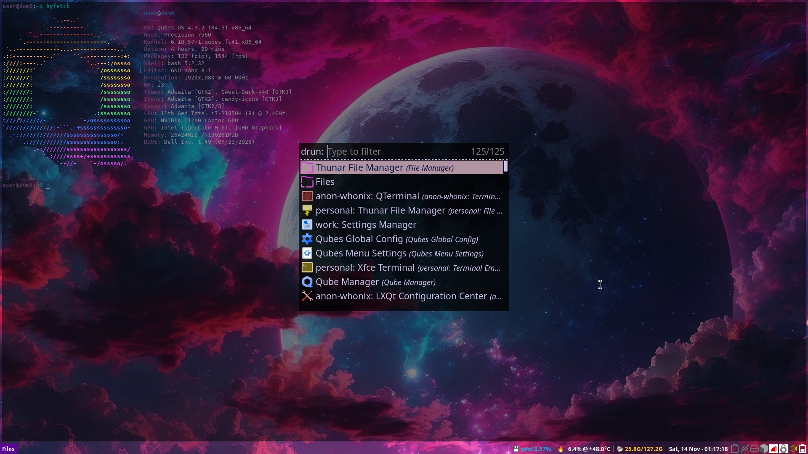

# qubes-i3
Shell scripts and dot files for custom Qubes 4.3 with the i3 tiling window manager. Efficient and highly scripted workflow. Extremely organized key chords. Dark theme with just the right amount of color. Modular install script. Pre-configured apps. Keep your hands on the keyboard.

